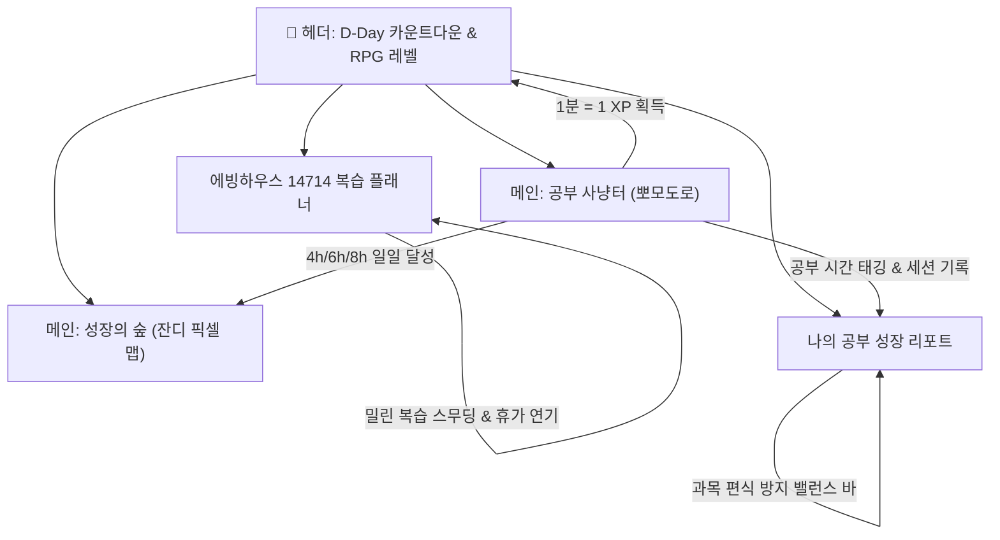

# 📖 Human OS (수험 스터디 다이어리) 종합 매뉴얼

> **Human OS**는 장기 레이스인 전문직(세무사 등) 시험 준비생을 위해 최적화된 **게이미피케이션 기반 수험 몰입 & 복습 자동화 다이어리 시스템**입니다.  
> 뽀모도로 집중 타이머, 에빙하우스 망각곡선 14714 주기 복습, 주간 10분 단위 타임테이블, 과목 편식 방지 밸런스 바, 실시간 D-Day 위젯이 유기적으로 연결되어 있습니다.

---

## 🗺️ 전체 시스템 구조도

---

## 1. 🎯 메인 화면 (1:1 듀얼 대시보드)

좌우 1:1 분할 레이아웃으로 집중 타이머와 잔디 달력을 동시에 직관적으로 관찰할 수 있습니다.

### 1-1. 공부 사냥터 (뽀모도로 집중 타이머)
- **집중 프리셋 & 자유 설정:**
  - `30분`, `60분` 원클릭 프리셋 및 `1분 ~ 180분` 직접 입력 지원.
- **과목 태깅 칩 (`+ 관리`):**
  - 타이머 시작 전 공부할 과목(`세화`, `행소`, `재무`, `원가` 등)을 클릭 한 번으로 선택.
  - `+ 관리` 버튼을 통해 나만의 과목을 추가/삭제 가능.
- **완료 및 타임라인 기록:**
  - 목표 시간 종료 시 완료 벨소리(`bell2.mp3`) 및 브라우저/모바일 푸시 알림 발송.
  - `조기 완료` 지원: 목표 시간 전에 공부를 끝내더라도 실제 공부한 분량만큼 정확히 기록 및 XP 적립.
  - **오늘 집중 타임라인:** 오늘 완료한 회차별 시작 시간, 종료 시간, 소요 분, 과목 뱃지가 순차적으로 기록되며 개별 삭제 및 수동 시간대 추가 지원.
- **PWA 백그라운드 세션 보존:**
  - 브라우저나 앱을 닫아도 백그라운드 시간을 계산하여 앱을 다시 열었을 때 자동으로 집중 완료 기록을 처리.

### 1-2. 성장의 숲 (잔디 픽셀 달력)
- **순수 집중 시간 기반 식생 렌더링:**
  - `🌱 새싹`: 순공 4시간 이상 달성 (기본 목표)
  - `🌿 성장`: 순공 6시간 이상 달성
  - `🌲 울창`: 순공 8시간 이상 달성 (초집중 데이)
  - `🌴 휴가`: 여행/휴가 모드 설정 일자
- **날짜 탐색 & 동기화:**
  - 달력의 특정 날짜를 클릭하면 해당 일자의 상세 집중 타임라인으로 즉각 전환.
  - 상단 `< [2026년 11월] >` 버튼과 `이번달` 복귀 버튼으로 과거 및 미래 달력 자유롭게 탐색.
  - 연속 달성 스트릭(Streak) 및 총 누적 식생 수 집계.

---

## 2. 🧠 에빙하우스 14714 복습 플래너

망각곡선 이론을 수험 현장에 맞게 최적화한 당일 시작 복습 스케줄러입니다.

### 2-1. 복습 주기 및 강의 등록
- **1471430 당일 시작 주기:**
  - 새로운 강의나 단원을 공부한 날 등록하면 **당일(1일차), 4일차, 7일차, 14일차, 30일차** 일정이 달력에 자동 생성됩니다.
- **원클릭 과목 칩 선택:**
  - 등록할 때마다 과목명을 직접 입력할 필요 없이 등록된 과목 칩을 눌러 즉시 선택.

### 2-2. 과부하 방지 & 일정 재배치
- **🌿 하루 최대 2개 자동 스무딩 (재무회계 등):**
  - 특정 과목의 복습이 특정 날짜에 과도하게 몰리지 않도록 하루 최대 2개 한도로 순차 분산 배치.
- **⚡ 미뤄진 복습 재배치:**
  - 공부하지 못하고 지난 복습(Overdue) 발생 시 알림 배너가 표시되며, **'하루 2개씩 순차 균등 분배'** 또는 **'오늘로 당겨오기'**를 지원.

### 2-3. 🌴 여행 / 휴가 모드
- 시험 기간 중 여행, 휴가, 경조사 등으로 공부가 어려운 기간을 등록.
- 등록된 일수만큼(1일이면 1칸, 3일이면 3칸) 복습 일정이 뒤로 안전하게 자동 순연되어 일정 누락 방지.
- 달력에 휴가 표시(`🌴`)가 기록되어 스트릭(Streak)이 초기화되지 않도록 보호.
- 지난 휴가 내역은 자동 숨김 처리되어 현재/예정된 휴가만 깔끔하게 관리.

---

## 3. 📊 나의 공부 성장 리포트 (통합 관찰 센터)

수험생의 주간 공부 패턴과 과목 밸런스를 한 페이지에서 종합적으로 분석하는 공간입니다.

### 3-1. 핵심 요약 바 (10/11 기준 집계)
- **총 출석일 (`10/11부터`):** 실질적인 본격 수험 레이스 시작일인 10월 11일 이후의 활동 일자만 엄격하게 집계.
- **누적 공부 시간 (`10/11부터`):** 10월 11일 이후의 총 순공 시간.
- **이번 주 집중 시간:** 현재 선택된 주(일~토)의 총 집중 시간.

### 3-2. 주간 일별 집중 시간 트렌드 (막대 그래프)
- **일요일 ~ 토요일 달력 주기:** 실제 주간 생활 패턴에 맞추어 일요일부터 토요일까지의 집중 시간을 막대바로 표시.
- **정교한 Baseline 가이드라인:**
  - 막대바 바닥선과 y축 0시간 기준선이 완벽히 일치하도록 설계.
  - `🌱 4시간`, `🌿 6시간`, `🌲 8시간`, `🔥 10시간` 기준선 및 이모티콘 표기.
- **상세 세션 드릴다운:**
  - 특정 요일 막대를 클릭하면 하단에 해당 일자의 타임스탬프와 과목별 상세 세션 뱃지 즉시 표출.

### 3-3. 🎨 과목별 공부시간 밸런스 바 (과목 편식 방지)
- **주간 집중 시간 누적 분배 게이지:**
  - 이번 주에 공부한 과목들의 시간 비율을 멀티 컬러 수평 누적 바로 시각화.
- **과목별 시간 및 점유율(%) 뱃지:**
  - 등록된 모든 과목의 공부 시간과 비율을 표시하여, 공부가 부족한 과목(0% 등)을 한눈에 식별하고 과목 편식을 예방.
  - 리포트 화면 내에서 즉시 `+ 과목 관리` 모달 호출 가능.

### 3-4. 📅 주간 스터디 타임테이블 (10분 그리드 · 5분 반칸 지원)
- **한국형 스터디 플래너 양식:**
  - 오전 06:00부터 익일 새벽 05:00까지 24시간을 10분 단위(한 시간에 6칸)로 분할.
- **실측 시간 자동 매핑:**
  - 뽀모도로 세션의 시작 시간과 종료 시간을 바탕으로 10분 풀칸(`■`) 및 5분 반칸(`▌`)을 자동 색칠.

---

## 4. 🎯 D-Day 위젯 & 게이미피케이션 (RPG 시스템)

### 4-1. 🎯 실시간 1차 / 2차 D-Day 위젯
- 메인 헤더 상단에 **`🎯 1차: D-112 | 2차: D-231`** 형태의 칩 위젯 배치.
- 칩을 클릭하거나 환경 설정에서 시험 명칭(`1차 시험`, `2차 시험`, `모의고사` 등)과 목표 날짜를 자유롭게 변경 가능.
- 자정마다 자동으로 남은 일수를 실시간 재계산.

### 4-2. 🏆 게이미피케이션 RPG 성장 시스템
- **경험치(XP) 획득 공식:**
  - 뽀모도로 집중 1분 = `1 XP`
  - 에빙하우스 복습 완료 = 추가 보너스 XP
  - 4시간, 6시간, 8시간 연속 집중 마일스톤 달성 시 보너스 XP 팝업
- **티어 등급 시스템 (도감 제공):**
  - `브론즈 (Lv.1~9)`: 공부 입문자
  - `실버 (Lv.10~29)`: 습관 형성자
  - `골드 (Lv.30~69)`: 수험 몰입자
  - `플래티넘 (Lv.70~119)`: 회독 장인
  - `그랜드 마스터 (Lv.120+)`: 예비 합격자
- 헤더의 랭크 뱃지를 클릭하면 등급 도감 확인 가능, 레벨업 시 화려한 폭죽과 축하 모달 연출.

---

## 5. ⚙️ 데이터 안전 보존 및 환경 설정

- **📦 데이터 전체 백업 및 복원 (JSON):**
  - 모든 타이머 기록, 복습 일정, 휴가 내역, 과목 및 D-Day 설정을 JSON 파일로 백업 및 복원.
  - PC 환경에서는 브라우저 파일 다운로드, 태블릿/모바일 앱 환경에서는 네이티브 공유(`Share`) 및 기기 저장 지원.
- **✨ 경험치(XP) 자동 복구:**
  - 과거의 뽀모도로 집중 기록 전체를 역추적하여 내 XP와 레벨을 오차 없이 재계산하는 복구 도구 제공.
- **📱 PWA (Progressive Web App) 오프라인 지원:**
  - 네트워크 연결이 불안정한 독서실이나 지하철에서도 설치형 앱처럼 끊김 없이 작동.
  - 새 버전 배포 시 헤더에 `🚀 업데이트` 버튼이 나타나 클릭 한 번으로 무중단 갱신.

---

## 💡 하루 권장 루틴 (Best Practice)

| 시간대 | 추천 작업 | 시스템 활용 팁 |
|:---|:---|:---|
| **아침 (08:00)** | 목표 확인 & 복습 체크 | 헤더 D-Day 확인 → `에빙하우스 복습`에서 오늘 예정된 복습 강의 확인 |
| **낮 (공부 세션)** | 과목별 집중 공부 | 과목 칩 클릭(예: `세화`) → 30분/60분 타이머 가동 → 완료 후 타임라인 확인 |
| **저녁 (마무리)** | 복습 일정 생성 | 오늘 인강으로 새로 배운 단원을 `에빙하우스 강의 등록`에 원클릭 등록 |
| **밤 (취침 전)** | 성장 관찰 & 밸런스 체크 | `성장 리포트` 열기 → 주간 타임테이블 색칠 상태 확인 → `과목별 밸런스 바`로 편식 여부 점검 |
